  
  
  
  

  

  

  

 

Most of my work lives in private <a href="https://github.com/DFCflow">DFCflow</a> repositories. Side projects and experiments: <a href="https://github.com/zaden81">@zaden81</a>.

